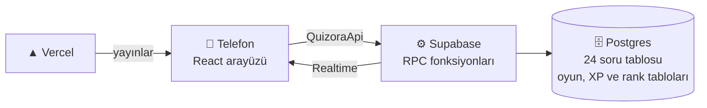

<p align="center">
  
</p>


<h3 align="center">Soru çözmeyi bir düelloya çeviriyoruz: aynı sorular, aynı anda, en hızlı ve en doğru kazanır.</h3>

🔗 Canlı demo: [https://quizora-liard.vercel.app] · 🎥 Demo videosu: []

*İşler Teknoloji EdTech Game Jam, 13-14 Kasım 2026 · Takım: TroyaDevs*

## 🎮 Nasıl Oynanır?
Quizora'da herkes aynı 10 soruyu aynı anda kendi telefonundan çözer. Hızlı ve doğru bilen daha çok puan alır, en yüksek puanı toplayan yarışmayı kazanır.

### 1. Profilini oluştur
Oyuna ilk girişte bir isim yaz ve hazır avatarlardan birini seç ya da kendi fotoğrafını yükle. Kayıt ya da şifre gerekmez.

### 2. Sınavını ve kategorini seç
Önce **YKS** ya da **LGS**'yi seç:
- **YKS:** Sayısal, Eşit Ağırlık, Sözel, TYT
- **LGS:** Sözel Oturum, Sayısal Oturum

### 3. Yarışa gir
- **Hemen Katıl:** Kategoriyi seç ve tek dokunuşla uygun bir lobiye gir. Aynı kategoride bekleyen oyuncu varsa onunla eşleşirsin, yoksa yeni bir lobi açılır. İkinci oyuncu gelince 10 saniye sonra yarış kendiliğinden başlar.
- **Özel lobi:** Lobi kur, kodu ya da QR'ı arkadaşlarınla paylaş. Başlatmak için en az 2 oyuncu gerekir; lobiyi kuran **Yarışmayı başlat**'a basar.

Bir lobide en fazla 5 oyuncu olur. Yarışı başlatmak için en az 2 oyuncu gerekir. Lobiyi kuran oyuncu **Yarışmayı başlat**'a basar ve herkeste 3-2-1 geri sayımı başlar.

### 4. Yarış
- Toplam süre **120 saniyedir**. Herkes aynı 10 soruyu görür, ama soruları kendi hızında çözer.
- Bir şık seçince sonuç anında animasyonla görünür: doğruysa puan kazanırsın, yanlışsa puan kaybedersin.
- **Ne kadar hızlı cevaplarsan hız bonusu o kadar büyük olur.**
- Ekranda canlı sıralama akar: rakiplerin puanı ve kaçıncı soruda oldukları anlık görünür.

### 5. 2× hız modu
İlk bitiren oyuncu 10 soruyu tamamladığı anda **kalan süre iki kat hızlı akmaya başlar**. Ekranda şimşek ve ateş efektleri belirir. Henüz bitirmemiş oyuncular kalan sorulara yetişmeye çalışır; bitirenlerin puanı sabit kalır, sıralama ise canlı güncellenmeye devam eder.

### 6. Sonuç ve inceleme
Süre dolunca ya da herkes bitirince sonuç ekranı açılır: sıralama, doğru/yanlış/boş sayın, puan dökümün, kazandığın XP ve rank atladıysan rank atlama animasyonu. Altında 10 soru şerit şerit listelenir; bir şeride dokununca doğru şıkkı ve **çözüm açıklamasını** görür, hatalarından öğrenirsin.

## 😩 Problem

YKS ve LGS'ye hazırlanan öğrenciler günlerini tek başına soru çözerek geçiriyor. Bu çalışma biçiminde anlık geri bildirim ve rakip yok; motivasyon düşünce çalışma da bırakılıyor. Mevcut soru çözme uygulamalarının çoğu bireysel ve sessiz. Rekabetli ve eğlenceli EdTech alanında oyun projeleri sektörde çok zayıf kalıyor.

## 💡 Çözüm

Quizora, öğrencilerin arkadaşlarıyla veya rastgele insanlarla **eş zamanlı** yarıştığı bir soru oyunu. Yoğun çalışma temposunda bulunan öğrenciler oyun oynarken aynı zamanda bilgilerini tekrar ediyor ve yanlışlarını öğreniyor. Aynı lobide yarışan oyuncular aynı 10 soruyu 120 saniyede çözüyor. Her cevapta anında doğru/yanlış animasyonu, canlı sıralama ve puan geliyor. Hız da ödüllendiriliyor: ne kadar çabuk doğru bilirseniz o kadar çok puan alırsınız. Tıpkı gerçek sınav sistemlerimizde olduğu gibi.

Heyecanı artırmak için bir de **2× hız modu** var: ilk bitiren oyuncu 10. soruyu tamamlayınca kalan süre iki kat hızlı akıyor, ekranda şimşek ve ateş efektleri başlıyor.

## 🛠️ Neler Yaptık?

- **YKS ve LGS:** YKS'de Sayısal, Eşit Ağırlık, Sözel, TYT; LGS'de Sözel ve Sayısal oturum. 24 ayrı ders tablosundan oluşan soru havuzu, demo sürümü için  94 gerçek soruyla (bazıları görselli).
- **Çok oyunculu lobi:** lobiler 5 kişiye kadar; ister arkadaşlarınla lobi kur, ister hemen katıl özelliği ile rastgele insanlar ile oyna.
- **Adil puanlama:** Puan yalnızca sunucuda hesaplanıyor; doğru şık cevaptan önce kimseye gönderilmiyor. Süre, cihaz saatine değil sunucu saatine göre işliyor, bu yüzden tüm telefonlarda sayaç aynı.
- **Sıralamalı ilerleme:** Her yarıştan XP kazanılıyor; XP'ye göre Çaylak'tan Efsane'ye uzanan bir rank sistemi ve canlı liderlik tablosu var.
- **Kayıtsız giriş:** Öğrenci ismini ve avatarını seçip hemen oynayabiliyor.

## ⚙️ Nasıl Yaptık?


React, TypeScript, Vite ve Tailwind ile arayüz; Supabase (Postgres, Realtime, Auth, Storage) ile veritabanı, oyun mantığı ve canlı akış; Vercel ile yayın. Oyunun tüm kuralları (puan, süre, 2× mod, XP) veritabanı fonksiyonlarında çalışıyor, arayüz yalnızca gösteriyor ve cevap gönderiyor. İki kişilik ekip olarak işi backend ve arayüz diye ayırdık; arayüz ile backend arasında tek bir tip sözleşmesi (`QuizoraApi`) tanımlayıp birbirimizi beklemeden çalıştık.

## ✨ Özellikler

## ✨ Özellikler

- 🎓 **YKS ve LGS:** YKS'de Sayısal, Eşit Ağırlık, Sözel ve TYT; LGS'de Sözel ve Sayısal oturum. Her yarış 10 sorudur; YKS 5 şıklı, LGS 4 şıklıdır.
- ⚡ **Hemen Katıl:** Oda kurmadan ya da kod girmeden, kategoriye göre otomatik eşleşme. Rakip yoksa yeni lobi açılır ve rakip aranır; ikinci oyuncu gelince 10 saniye sonra yarış kendiliğinden başlar.
- 👥 **Özel lobi:** Arkadaşlarla 5 kişiye kadar, lobi kodu (`QZ-XXXX`) ve QR kodla katılım. Kayıt ya da şifre gerekmez.
- ⏱️ **Eş zamanlı yarış:** Herkes aynı 10 soruyu aynı anda görür, 120 saniyelik sürede kendi hızında çözer.
- 🎯 **Hız bonuslu puanlama:** Doğru cevap 100-200 puan (ne kadar hızlıysan o kadar çok), yanlış −25, boş 0.
- 🔥 **2× hız modu:** İlk bitiren 10. soruyu tamamlayınca kalan süre iki kat hızlı akar; şimşek ve ateş efektleri başlar.
- 📊 **Canlı sıralama:** Puanlar ve soru ilerlemesi anlık güncellenir, satırlar animasyonla yer değiştirir.
- 📝 **Soru incelemesi:** Yarış bitince her soru için doğru/yanlış/boş durumun, seçtiğin ve doğru şık, puanın, süren ve 1-2 cümlelik çözüm açıklaması görünür.
- 🏆 **XP ve rank:** Her yarıştan XP kazanılır; Çaylak'tan Efsane'ye 14 basamaklı lig ve canlı liderlik tablosu.
- 🖼️ **Görselli sorular:** Şekil, grafik ve fotoğraf içeren sorular desteklenir.
- 🔁 **Kaldığın yerden devam:** Sayfa yenilense de oyun kaldığın sorudan sürer.
- 📱 **Telefon odaklı:** iPhone Safari başta olmak üzere mobil ve web için tasarlandı.

## 🏆 XP ve Rank Sistemi

Her yarış sonunda oyuncular **XP** kazanır. Rank, toplam XP'ye göre belirlenir ve **yalnızca yükselir** (düşme yoktur). Böylece ilk yarışlar hızlı rank atlatır, üst ranklar uzun vadeli hedef olur.

### XP nasıl hesaplanır?

```
XP = 20 (katılım) + puan / 10 + yerleşim bonusu + 10 (ilk bitiren)
```

| Yerleşim | Bonus |
| --- | --- |
| 1. | +30 |
| 2. | +15 |
| 3. | +8 |
| Diğerleri | 0 |

- **Puan / 10** için toplam puanın onda biri alınır (aşağı yuvarlanır, negatif olamaz).
- **İlk bitiren** bonusunu 10 soruyu en önce tamamlayan oyuncu alır.
- XP yalnızca **en az 2 oyunculu** yarışta ve **en az bir soru cevaplayan** oyuncuya verilir.
- Bir yarışın XP'si **yalnızca bir kez** işlenir; sonuç ekranı kaç kez açılsa da XP tekrar eklenmez.
- Bir yarışta en fazla 260 XP kazanılabilir.

### Rank tablosu

| Rank | Kademeler (gereken toplam XP) |
| --- | --- |
| 🌱 Çaylak | 0 |
| 🥉 Bronz | I: 100 · II: 150 · III: 200 |
| 🥈 Gümüş | I: 260 · II: 330 · III: 400 |
| 🥇 Altın | I: 480 · II: 570 · III: 660 |
| 💎 Elmas | I: 760 · II: 870 · III: 980 |
| 👑 Efsane | 1100 |

Sonuç ekranında XP dökümü (katılım, puan, yerleşim, ilk bitiren), XP çubuğunun dolması ve rank atlandıysa **rank atlama animasyonu** gösterilir. Ana menüdeki liderlik tablosu XP'ye göre sıralanır ve her satırda rank rozeti, XP ve galibiyet sayısı yer alır.

## 🧱 Mimari

Oyunun tüm kuralları (eşleşme, puanlama, süre, 2× hız, XP, soru incelemesi) veritabanı fonksiyonlarında çalışır. Arayüz yalnızca gösterir ve cevap gönderir.



| Katman | Teknoloji | Görevi |
| --- | --- | --- |
| Arayüz | React, TypeScript, Vite, Tailwind CSS | Ekranlar, animasyonlar, QR kod; mobil ve web |
| Veritabanı | Supabase Postgres | 24 soru tablosu (18 YKS, 6 LGS), oyun, oyuncu, cevap, XP tabloları |
| Oyun mantığı | Postgres RPC fonksiyonları | Oyun kurma, katılma, soru verme, puanlama, bitirme, XP, inceleme |
| Eşleşme | `quick_join`, `start_if_ready`, `leave_game` | Kategori başına kilitli hızlı eşleşme, host'suz otomatik başlama |
| İnceleme | `get_game_review` | Biten yarış için cevaplar, doğru şık ve çözüm açıklaması |
| Canlı akış | Supabase Realtime | Lobi, canlı sıralama, 2× mod, liderlik |
| Kimlik | Supabase Anonymous Auth | Kayıtsız giriş |
| Depolama | Supabase Storage | Avatar, profil fotoğrafı ve soru görselleri |
| Yayın | Vercel | `main` dalındaki her birleştirmede otomatik yayın |

Arayüz ile backend arasındaki **tek bağ** `src/types.ts` içindeki `QuizoraApi` arayüzüdür. Arayüz, backend hazır olana kadar aynı arayüzü uygulayan bir sahte (mock) servisle geliştirildi; bir ortam değişkeniyle (`VITE_USE_MOCK`) gerçek servise geçilir.

### Veritabanı yapısı

| Grup | İçerik |
| --- | --- |
| Soru tabloları (24) | 18 YKS (TYT ve AYT dersleri) + 6 LGS (Türkçe, İnkılap, Din Kültürü, İngilizce, Matematik, Fen). Hepsinde aynı sütunlar; `aciklama` dahili not, `cozum_aciklamasi` öğrenciye gösterilen çözüm |
| Oyun tabloları | `profiles`, `games`, `game_players`, `game_questions`, `answers` |
| XP ve rank | `player_stats`, `rank_tiers` (14 basamak) |
| Ayarlar | `app_settings` (örneğin `min_players`) |

Ana RPC'ler: `create_game`, `quick_join`, `join_game`, `start_game`, `start_if_ready`, `leave_game`, `get_game`, `get_game_by_id`, `get_question`, `submit_answer`, `finish_game`, `get_game_review`, `get_my_stats`, `get_global_leaderboard`, `server_time`.

### Bir yarışın akışı

1. Oyuncu **Hemen Katıl** (`quick_join`) ile uygun herkese açık lobiye girer ya da özel lobi kurar (`create_game`); sunucu kategoriye göre 10 soruyu rastgele ve tekrarsız seçer.
2. İkinci oyuncu gelince geri sayım başlar; süre dolunca `start_if_ready` (ya da özel lobide host'un `start_game`'i) yarışı başlatır.
3. Oyuncu her soruyu `get_question` ile alır (doğru şık olmadan), `submit_answer` ile cevaplar; puan sunucuda hesaplanır.
4. İlk bitiren oyuncu 2× hız modunu tetikler; sunucu o anı ve kalan süreyi kaydeder.
5. Süre dolunca ya da herkes bitirince `finish_game` sonucu, XP ve rank değişimini hesaplar.
6. Yarış bittikten sonra `get_game_review` oyuncunun cevaplarını, doğru şıkları ve çözüm açıklamalarını döndürür.

## 🔒 Güvenlik

- 🧮 **Puan yalnızca sunucuda hesaplanır.** İstemcide görünen puan sunucudan gelen değerdir; arayüz değiştirilerek puan artırılamaz.
- 🤐 **Doğru şık cevaptan önce gönderilmez.** Soru tablolarına arayüzden doğrudan erişim kapalıdır (Row Level Security); sorular yalnızca yetkili veritabanı fonksiyonlarıyla okunur.
- 🕐 **Sunucu saati esastır.** Süre, cihaz saatine değil sunucu zamanına göre hesaplanır; tüm telefonlarda sayaç ve 2× hız geçişi aynıdır. Cevap süresi de sunucuda ölçülür.
- 🔁 **Tekrar çalıştırılabilir bitirme.** `finish_game` birden fazla kez ve aynı anda çağrılsa da tek sonuç üretir; XP ve galibiyet çifte yazılmaz.
- 🚪 **Yetki kontrolü.** Oyuncu yalnızca üyesi olduğu oyunu görebilir; kendi XP'sini ya da puanını doğrudan değiştiremez.
- 🔑 **Gizli anahtar istemcide yoktur.** `service_role` / `secret` anahtarı yalnızca yerel `scripts/` için kullanılır, hiçbir zaman `VITE_` önekiyle yazılmaz ve repoya girmez; yayın ortamına eklenmez.
- ✅ **Otomatik testler.** `scripts/security-test.ts` yukarıdaki kuralları dener: oturumsuz erişim, üye olmayan oyuncu, doğrudan yazma, hileli cevaplar, eşzamanlı bitirme ve XP tekrarı.

### Canlı akış

Arayüz, lobi ve oyun durumunu `games` ve `game_players` değişikliklerini dinleyerek (Realtime) alır; ayrıca birkaç saniyede bir durumu yeniden çekerek bağlantı kopsa bile ekranın donmamasını sağlar. Sayaç, cihaz saatine değil sunucu saatine göre hesaplanır (sunucu-istemci farkı ölçülür), bu yüzden tüm telefonlarda geri sayım ve 2× geçişi aynıdır.

## 🚀 Kurulum

### Gereksinimler
- Node.js 20 veya üzeri (geliştirmede 22 kullanıldı) ve Git
- Ücretsiz bir [Supabase](https://supabase.com) hesabı
- (İsteğe bağlı) Yayın için [Vercel](https://vercel.com) hesabı

### 1. Projeyi indir
```bash
git clone https://github.com/beratvarlik/quizora.git
cd quizora
npm install
```

### 2. Supabase projesini hazırla
1. Supabase'de yeni bir proje oluştur (bölge: Frankfurt).
2. **Authentication → Sign In / Providers → User Signups** bölümünde **Allow anonymous sign-ins** seçeneğini aç ve kaydet.
3. **Project Settings → API** sayfasından **Project URL** ve **publishable (anon)** anahtarını kopyala. Betikler için **secret (service_role)** anahtarına da ihtiyacın olacak.
4. Çok kişiyle deneyeceksen **Authentication → Rate Limits** bölümünde anonim giriş sınırını yükselt (varsayılan IP başına saatte 30; aynı Wi-Fi'den gelen kalabalık için 500 gibi bir değer ver).

### 3. Ortam değişkenleri
Proje kökünde `.env.local` dosyası oluştur (repoya girmez):

```
VITE_SUPABASE_URL=https://xxxx.supabase.co
VITE_SUPABASE_ANON_KEY=sb_publishable_...
VITE_USE_MOCK=false
SUPABASE_SERVICE_ROLE_KEY=sb_secret_...
```

| Değişken | Anlamı |
| --- | --- |
| `VITE_SUPABASE_URL` | Supabase proje adresi |
| `VITE_SUPABASE_ANON_KEY` | Herkese açık (publishable/anon) anahtar |
| `VITE_USE_MOCK` | `true` ise sahte servis, `false` ise gerçek Supabase |
| `SUPABASE_SERVICE_ROLE_KEY` | Yalnızca `scripts/` için; **asla `VITE_` ile yazma, asla paylaşma** |

> [!WARNING]
> `service_role` / `secret` anahtarı tüm güvenliği atlar. Repoya, sohbetlere ve yayın ortamına (Vercel) **girmez**.

Bağlantıyı denemek için: `npx tsx scripts/ping.ts` (sonda `OK` görmelisin).

### 4. Veritabanını kur
`supabase/migrations` klasöründeki **tüm** SQL dosyalarını **numara sırasıyla** Supabase **SQL Editor**'de çalıştır (dosyayı aç, içeriği yapıştır, Run). Sonra doğrula:

```bash
npx tsx scripts/check-schema.ts
```

### 5. Soruları yükle
Hızlı deneme için test sorularıyla başlayabilirsin:

```bash
npx tsx scripts/seed-test-questions.ts          # örnek [TEST] soruları ekler
npx tsx scripts/seed-test-questions.ts --temizle  # hepsini siler
```

Gerçek sorular için CSV şablonunu (`scripts/soru-sablonu.csv`) doldurup yükle. Sütunlar: `tablo, soru_metni, secenek_a … secenek_e, dogru_sik, gorsel_dosya, aciklama` (LGS soruları 4 şıklıdır, `secenek_e` boş bırakılır). Ayrıntı: [`docs/SORU-EKLEME.md`](docs/SORU-EKLEME.md).

```bash
npx tsx scripts/import-questions.ts sorular.csv --dry-run --gorsel-klasor gorseller
npx tsx scripts/import-questions.ts sorular.csv --gorsel-klasor gorseller
```

Öğrenciye gösterilen **çözüm açıklamaları** ayrı bir CSV ile yüklenir (sütunlar: `tablo, soru_metni, cozum_aciklamasi`):

```bash
npx tsx scripts/aciklama-yukle.ts aciklamalar.csv --dry-run
npx tsx scripts/aciklama-yukle.ts aciklamalar.csv
```

Hangi kategorinin oynanabilir ve açıklamalı olduğunu görmek için:

```bash
npx tsx scripts/soru-durumu.ts
```

### 6. Oyuncu sayısı ayarı
Yarışın başlaması için en az oyuncu sayısı `app_settings` tablosundadır (varsayılan 2). SQL Editor'de değiştirmek için:

```sql
update app_settings set value = '2' where key = 'min_players';
```

### 7. Çalıştır
```bash
npm run dev
```
Tarayıcıda `http://localhost:5173` adresini aç. İki oyuncuyu denemek için biri normal, biri **gizli pencerede** açılır.

### 8. Test ve derleme
```bash
npm run build                      # tip kontrolü + üretim derlemesi
npx tsx scripts/e2e-sim.ts         # uçtan uca simülasyon
npx tsx scripts/security-test.ts   # güvenlik testleri
```

> [!NOTE]
> `scripts/hepsi.ts` çok sayıda anonim kullanıcı oluşturur. Supabase'in anonim giriş sınırını yükseltmeden ve yayındaki siteye karşı çalıştırma.

### 9. Demo araçları (isteğe bağlı)
Sunum hazırlığı için, **yalnızca demo amacıyla**:

```bash
npx tsx scripts/xp-ayarla.ts "<oyuncu adı>" 95   # oyuncunun XP'sini ayarlar (rank atlamasını göstermek için)
```

Tek başına bekleyen oyuncuya demo rakipleri eklemek için bot modu (varsayılan **kapalı**; botların adı "(bot)" ile biter ve liderliğe girmez):

```bash
npx tsx scripts/bot-olustur.ts      # bot hesaplarını oluşturur
```
```sql
update app_settings set value = 'acik' where key = 'bot_modu';   -- açar
update app_settings set value = 'kapali' where key = 'bot_modu'; -- kapatır
```

## 🧗 Karşılaştığımız Zorluklar

- **Senkron sayaç:** Telefonların saatleri farklıyken herkes için aynı geri sayımı ve 2× hız geçişini sağlamak için sunucu zamanına göre ölçüm yaptık.
- **Eşzamanlı bitirme:** Birden fazla oyuncu aynı anda son soruyu gönderdiğinde ya da yarışı bitirdiğinde çifte puan veya XP yazılmaması için kilitleme ve tekrar çalıştırılabilir (idempotent) bitirme mantığı kurduk.
- **Hileye karşı güvenlik:** Soru tablolarına arayüzden doğrudan erişimi kapatıp doğru şıkkı yalnızca cevaptan sonra döndürdük; bunu otomatik güvenlik testleriyle sınadık.
- **Farklı sınav biçimleri:** YKS 5 şıklı, LGS 4 şıklı olduğu için soru yapısını ve arayüzü iki biçime uyumlu hale getirdik.

## 🚧 Sınırlar ve Sonraki Adımlar

Soru havuzunu demo sürümü için 94 soru ile sınırlı tuttuk. İlerleyen süreçte öğretmenler, yayınevleri ve öğrenciler ile işbirliği yaparak çok daha üst düzeye çıkartmak ilk etaptaki planımız. Sonraki adımlar: Dil kategorisi (YDT), özel oyun modları ile oda kurma, okul/sınıf bazlı liderlik tabloları. Ekosistem büyüdükçe daha farklı sınav çeşitleri ile her kitleye hitap etmek.

## 👥 Ekip - TroyaDevs

- **beratvarlik**: Backend (veritabanı, oyun mantığı, güvenlik, yayın.)
- **mustafabahafaik**: Arayüz ve tasarım (sesler, animasyonlar, görsel tasarımlar.)
