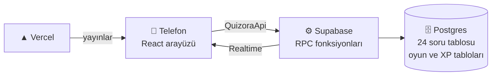

<p align="center">
  
</p>


<h3 align="center">Soru çözmeyi bir düelloya çeviriyoruz: aynı sorular, aynı anda, en hızlı ve en doğru kazanır.</h3>

🔗 Canlı demo: [https://quizora-liard.vercel.app] · 🎥 Demo videosu: []

*İşler Teknoloji EdTech Game Jam, 13-14 Kasım 2026 · Takım: TroyaDevs*

## 🎮 Nasıl Oynanır?
Quizora'da herkes aynı 10 soruyu aynı anda kendi telefonundan çözer. Hızlı ve doğru bilen daha çok puan alır, en yüksek puanı toplayan yarışmayı kazanır.

### 1. Profilini oluştur
Oyuna ilk girişte bir isim yaz ve hazır avatarlardan birini seç ya da kendi fotoğrafını yükle. Kayıt ya da şifre gerekmez.

### 2. Sınavını ve kategorini seç
Önce **YKS** ya da **LGS**'yi seç:
- **YKS:** Sayısal, Eşit Ağırlık, Sözel, TYT
- **LGS:** Sözel Oturum, Sayısal Oturum

### 3. Lobiye gir
- **Lobi kur:** Seçtiğin kategoriyle bir lobi oluşturursun. Ekranda lobi kodu (`QZ-XXXX`) ve bir QR kod çıkar.
- **Lobiye katıl:** Arkadaşının QR kodunu telefon kamerasıyla okut ya da menüde lobi kodunu gir.

Bir lobide en fazla 5 oyuncu olur. Yarışı başlatmak için en az 2 oyuncu gerekir. Lobiyi kuran oyuncu **Yarışmayı başlat**'a basar ve herkeste 3-2-1 geri sayımı başlar.

### 4. Yarış
- Toplam süre **120 saniyedir**. Herkes aynı 10 soruyu görür, ama soruları kendi hızında çözer.
- Bir şık seçince sonuç anında animasyonla görünür: doğruysa puan kazanırsın, yanlışsa puan kaybedersin.
- **Ne kadar hızlı cevaplarsan hız bonusu o kadar büyük olur.**
- Ekranda canlı sıralama akar: rakiplerin puanı ve kaçıncı soruda oldukları anlık görünür.

### 5. 2× hız modu
İlk bitiren oyuncu 10 soruyu tamamladığı anda **kalan süre iki kat hızlı akmaya başlar**. Ekranda şimşek ve ateş efektleri belirir. Henüz bitirmemiş oyuncular kalan sorulara yetişmeye çalışır; bitirenlerin puanı sabit kalır, sıralama ise canlı güncellenmeye devam eder.

## 😩 Problem

YKS ve LGS'ye hazırlanan öğrenciler günlerini tek başına soru çözerek geçiriyor. Bu çalışma biçiminde anlık geri bildirim ve rakip yok; motivasyon düşünce çalışma da bırakılıyor. Mevcut soru çözme uygulamalarının çoğu bireysel ve sessiz. Rekabetli ve eğlenceli EdTech alanında oyun projeleri sektörde çok zayıf kalıyor.

## 💡 Çözüm

Quizora, öğrencilerin arkadaşlarıyla veya rastgele insanlarla **eş zamanlı** yarıştığı bir soru oyunu. Yoğun çalışma temposunda bulunan öğrenciler oyun oynarken aynı zamanda bilgilerini tekrar ediyor ve yanlışlarını öğreniyor. Aynı lobide yarışan oyuncular aynı 10 soruyu 120 saniyede çözüyor. Her cevapta anında doğru/yanlış animasyonu, canlı sıralama ve puan geliyor. Hız da ödüllendiriliyor: ne kadar çabuk doğru bilirseniz o kadar çok puan alırsınız. Tıpkı gerçek sınav sistemlerimizde olduğu gibi.

Heyecanı artırmak için bir de **2× hız modu** var: ilk bitiren oyuncu 10. soruyu tamamlayınca kalan süre iki kat hızlı akıyor, ekranda şimşek ve ateş efektleri başlıyor.

## 🛠️ Neler Yaptık?

- **YKS ve LGS:** YKS'de Sayısal, Eşit Ağırlık, Sözel, TYT; LGS'de Sözel ve Sayısal oturum. 24 ayrı ders tablosundan oluşan soru havuzu, demo sürümü için  94 gerçek soruyla (bazıları görselli).
- **Çok oyunculu lobi:** lobiler 5 kişiye kadar; ister arkadaşlarınla lobi kur, ister hemen katıl özelliği ile rastgele insanlar ile oyna.
- **Adil puanlama:** Puan yalnızca sunucuda hesaplanıyor; doğru şık cevaptan önce kimseye gönderilmiyor. Süre, cihaz saatine değil sunucu saatine göre işliyor, bu yüzden tüm telefonlarda sayaç aynı.
- **Sıralamalı ilerleme:** Her yarıştan XP kazanılıyor; XP'ye göre Çaylak'tan Efsane'ye uzanan bir rank sistemi ve canlı liderlik tablosu var.
- **Kayıtsız giriş:** Öğrenci ismini ve avatarını seçip hemen oynayabiliyor.

## ⚙️ Nasıl Yaptık?


React, TypeScript, Vite ve Tailwind ile arayüz; Supabase (Postgres, Realtime, Auth, Storage) ile veritabanı, oyun mantığı ve canlı akış; Vercel ile yayın. Oyunun tüm kuralları (puan, süre, 2× mod, XP) veritabanı fonksiyonlarında çalışıyor, arayüz yalnızca gösteriyor ve cevap gönderiyor. İki kişilik ekip olarak işi backend ve arayüz diye ayırdık; arayüz ile backend arasında tek bir tip sözleşmesi (`QuizoraApi`) tanımlayıp birbirimizi beklemeden çalıştık.

## ✨ Özellikler

- 🎓 **YKS ve LGS:** YKS'de Sayısal, Eşit Ağırlık, Sözel ve TYT; LGS'de Sözel ve Sayısal oturum. Her yarış 10 sorudur ve soru dağılımı kategoriye göre sabittir.
- 👥 **Çok oyunculu lobi:** 5 kişiye kadar. Lobi kodu (`QZ-XXXX`) ve QR kodla katılım; kayıt ya da şifre gerekmez.
- ⏱️ **Eş zamanlı yarış:** Herkes aynı 10 soruyu aynı anda görür, 120 saniyelik sürede kendi hızında çözer.
- ⚡ **Hız bonuslu puanlama:** Doğru cevap 100 ile 200 arası puan verir (ne kadar hızlıysan o kadar çok), yanlış cevap −25, boş 0.
- 🔥 **2× hız modu:** İlk bitiren oyuncu 10. soruyu tamamlayınca kalan süre iki kat hızlı akar; şimşek ve ateş efektleri başlar.
- 📊 **Canlı sıralama:** Her oyuncunun puanı ve kaçıncı soruda olduğu anlık güncellenir, satırlar animasyonla yer değiştirir.
- 🏆 **XP ve rank sistemi:** Her yarıştan XP kazanılır; Çaylak'tan Efsane'ye uzanan 14 basamaklı bir lig ve canlı liderlik tablosu vardır.
- 🖼️ **Görselli sorular:** Şekil, grafik ve fotoğraf içeren sorular desteklenir.
- 🔁 **Kaldığın yerden devam:** Oyun sırasında sayfa yenilenirse oyuncu kaldığı sorudan devam eder.
- 📱 **Telefon odaklı:** iPhone Safari başta olmak üzere mobil ve web için tasarlandı.

## 🏆 XP ve Rank Sistemi

Her yarış sonunda oyuncular **XP** kazanır. Rank, toplam XP'ye göre belirlenir ve **yalnızca yükselir** (düşme yoktur). Böylece ilk yarışlar hızlı rank atlatır, üst ranklar uzun vadeli hedef olur.

### XP nasıl hesaplanır?

```
XP = 20 (katılım) + puan / 10 + yerleşim bonusu + 10 (ilk bitiren)
```

| Yerleşim | Bonus |
| --- | --- |
| 1. | +30 |
| 2. | +15 |
| 3. | +8 |
| Diğerleri | 0 |

- **Puan / 10** için toplam puanın onda biri alınır (aşağı yuvarlanır, negatif olamaz).
- **İlk bitiren** bonusunu 10 soruyu en önce tamamlayan oyuncu alır.
- XP yalnızca **en az 2 oyunculu** yarışta ve **en az bir soru cevaplayan** oyuncuya verilir.
- Bir yarışın XP'si **yalnızca bir kez** işlenir; sonuç ekranı kaç kez açılsa da XP tekrar eklenmez.
- Bir yarışta en fazla 260 XP kazanılabilir.

### Rank tablosu

| Rank | Kademeler (gereken toplam XP) |
| --- | --- |
| 🌱 Çaylak | 0 |
| 🥉 Bronz | I: 100 · II: 150 · III: 200 |
| 🥈 Gümüş | I: 260 · II: 330 · III: 400 |
| 🥇 Altın | I: 480 · II: 570 · III: 660 |
| 💎 Elmas | I: 760 · II: 870 · III: 980 |
| 👑 Efsane | 1100 |

Sonuç ekranında XP dökümü (katılım, puan, yerleşim, ilk bitiren), XP çubuğunun dolması ve rank atlandıysa **rank atlama animasyonu** gösterilir. Ana menüdeki liderlik tablosu XP'ye göre sıralanır ve her satırda rank rozeti, XP ve galibiyet sayısı yer alır.

## 🧱 Mimari
Oyunun tüm kuralları (puanlama, süre, 2× hız, XP) veritabanında çalışır; arayüz yalnızca gösterir ve cevap gönderir.



| Katman | Teknoloji | Görevi |
| --- | --- | --- |
| Arayüz | React, TypeScript, Vite, Tailwind CSS | Ekranlar, animasyonlar, QR kod; mobil ve web |
| Veritabanı | Supabase Postgres | 24 soru tablosu, oyun, oyuncu, cevap, XP tabloları |
| Oyun mantığı | Postgres RPC fonksiyonları | Oyun kurma, katılma, soru verme, puanlama, bitirme, XP |
| Canlı akış | Supabase Realtime | Lobi, canlı sıralama, 2× mod, liderlik |
| Kimlik | Supabase Anonymous Auth | Kayıtsız giriş |
| Depolama | Supabase Storage | Avatar, profil fotoğrafı ve soru görselleri |
| Yayın | Vercel | `main` dalındaki her birleştirmede otomatik yayın |

Arayüz ile backend arasındaki **tek bağ** `src/types.ts` içindeki `QuizoraApi` arayüzüdür. Arayüz, backend hazır olana kadar aynı arayüzü uygulayan bir sahte (mock) servisle geliştirildi; bir ortam değişkeniyle gerçek servise geçilir.

### Bir yarışın akışı

1. Host `create_game` ile oyunu kurar, sunucu kategoriye göre sorulardan 10 tanesini rastgele ve tekrarsız seçer.
2. Oyuncular `join_game` ile katılır; host `start_game` ile başlatır, başlangıç zamanı sunucuya yazılır.
3. Oyuncu her soruyu `get_question` ile alır (doğru şık olmadan), `submit_answer` ile cevaplar; puan sunucuda hesaplanır.
4. İlk bitiren oyuncu 2× hız modunu tetikler; sunucu o anı ve kalan süreyi kaydeder.
5. Süre dolunca ya da herkes bitirince `finish_game` sonucu, XP ve rank değişimini hesaplar.

## 🔒 Güvenlik

- 🧮 **Puan yalnızca sunucuda hesaplanır.** İstemcide görünen puan sunucudan gelen değerdir; arayüz değiştirilerek puan artırılamaz.
- 🤐 **Doğru şık cevaptan önce gönderilmez.** Soru tablolarına arayüzden doğrudan erişim kapalıdır (Row Level Security); sorular yalnızca yetkili veritabanı fonksiyonlarıyla okunur.
- 🕐 **Sunucu saati esastır.** Süre, cihaz saatine değil sunucu zamanına göre hesaplanır; tüm telefonlarda sayaç ve 2× hız geçişi aynıdır. Cevap süresi de sunucuda ölçülür.
- 🔁 **Tekrar çalıştırılabilir bitirme.** `finish_game` birden fazla kez ve aynı anda çağrılsa da tek sonuç üretir; XP ve galibiyet çifte yazılmaz.
- 🚪 **Yetki kontrolü.** Oyuncu yalnızca üyesi olduğu oyunu görebilir; kendi XP'sini ya da puanını doğrudan değiştiremez.
- 🔑 **Gizli anahtar istemcide yoktur.** `service_role` / `secret` anahtarı yalnızca yerel `scripts/` için kullanılır, hiçbir zaman `VITE_` önekiyle yazılmaz ve repoya girmez; yayın ortamına eklenmez.
- ✅ **Otomatik testler.** `scripts/security-test.ts` yukarıdaki kuralları dener: oturumsuz erişim, üye olmayan oyuncu, doğrudan yazma, hileli cevaplar, eşzamanlı bitirme ve XP tekrarı.

## 🚀 Kurulum

### Gereksinimler
- Node.js 20 veya üzeri (geliştirmede 22 kullanıldı) ve Git
- Ücretsiz bir [Supabase](https://supabase.com) hesabı
- (İsteğe bağlı) Yayın için [Vercel](https://vercel.com) hesabı

### 1. Projeyi indir
```bash
git clone https://github.com/beratvarlik/quizora.git
cd quizora
npm install
```

### 2. Supabase projesini hazırla
1. Supabase'de yeni bir proje oluştur (bölge: Frankfurt).
2. **Authentication → Sign In / Providers** bölümünde **Anonymous sign-ins** seçeneğini aç.
3. **Project Settings → API** sayfasından **Project URL** ve **publishable (anon)** anahtarını kopyala. Betikler için **secret (service_role)** anahtarına da ihtiyacın olacak.

### 3. Ortam değişkenleri
Proje kökünde `.env.local` dosyası oluştur (repoya girmez):

```
VITE_SUPABASE_URL=https://xxxx.supabase.co
VITE_SUPABASE_ANON_KEY=sb_publishable_...
VITE_USE_MOCK=false
SUPABASE_SERVICE_ROLE_KEY=sb_secret_...
```

| Değişken | Anlamı |
| --- | --- |
| `VITE_SUPABASE_URL` | Supabase proje adresi |
| `VITE_SUPABASE_ANON_KEY` | Herkese açık (publishable/anon) anahtar |
| `VITE_USE_MOCK` | `true` ise sahte servis, `false` ise gerçek Supabase |
| `SUPABASE_SERVICE_ROLE_KEY` | Yalnızca `scripts/` için; **asla `VITE_` ile yazma, asla paylaşma** |

Bağlantıyı denemek için: `npx tsx scripts/ping.ts` (sonda `OK` görmelisin).

### 4. Veritabanını kur
`supabase/migrations` klasöründeki SQL dosyalarını **numara sırasıyla** Supabase **SQL Editor**'de çalıştır (dosyayı aç, içeriği yapıştır, Run). Sonra doğrula:

```bash
npx tsx scripts/check-schema.ts
```

### 5. Soruları yükle
Test sorularıyla denemek için `npx tsx scripts/seed-test-questions.ts`. Gerçek sorular için CSV şablonunu doldurup yükle (ayrıntı: [`docs/SORU-EKLEME.md`](docs/SORU-EKLEME.md)):

```bash
npx tsx scripts/import-questions.ts sorular.csv --dry-run --gorsel-klasor gorseller
npx tsx scripts/import-questions.ts sorular.csv --gorsel-klasor gorseller
npx tsx scripts/soru-durumu.ts
```

`soru-durumu` hangi kategorinin oynanabilir olduğunu gösterir.

Yarış sonrası soru incelemesinde öğrenciye gösterilen çözüm açıklamaları (`cozum_aciklamasi`, en çok 400 karakter) ayrı bir CSV ile yüklenir: `npx tsx scripts/aciklama-yukle.ts aciklamalar.csv --dry-run` (ayrıntı: `docs/SORU-EKLEME.md`). Migration `0008_cozum_aciklamasi.sql` önce uygulanmış olmalı.

Akıllı analiz (Performansım) için her sorunun bir konusu (`topic`) vardır: yeni soru CSV'sinde `topic` sütunu zorunludur; mevcut sorulara `npx tsx scripts/konu-yukle.ts scripts/konu-atamalari.csv` ile yüklenir (migration `0011_akilli_analiz.sql` önce uygulanmış olmalı; ayrıntı: `docs/SORU-EKLEME.md` bölüm 2c).

### 6. Çalıştır
```bash
npm run dev
```
Tarayıcıda `http://localhost:5173` adresini aç. İki oyuncuyu denemek için biri normal, biri **gizli pencerede** açılır.

### 7. Test ve derleme
```bash
npm run build                      # tip kontrolü + üretim derlemesi
npx tsx scripts/e2e-sim.ts         # uçtan uca simülasyon
npx tsx scripts/security-test.ts   # güvenlik testleri
```

> [!NOTE]
> `scripts/hepsi.ts` çok sayıda anonim kullanıcı oluşturur. Supabase'in anonim giriş sınırı (varsayılan saatte 30) yükseltilmeden çalıştırma.

### Demo botları (yalnızca demo için)
Hemen Katıl ile tek başına bekleyen oyuncuya, istenirse sanal rakipler (bot) katılabilir. **Bu özellik yalnızca demo içindir ve varsayılan olarak KAPALIDIR.** Botlar kendilerini dürüstçe gösterir (adları "(bot)" ile biter), genel liderlik tablosuna ve XP istatistiklerine girmez; botlu yarışta oyuncu yalnızca katılım ve puan XP'si alır, kazanma sayısı artmaz. Açmak için önce `npx tsx scripts/bot-olustur.ts` çalıştırılır, sonra Supabase SQL Editor'de `update app_settings set value = 'acik' where key = 'bot_modu';` (kapatmak için `'kapali'`). Ayrıntı: `docs/PROJE.md` "Demo botları". Migration: `0013_demo_botlari.sql`.

### 8. Yayına al
Vercel'e GitHub reposunu bağla (Framework: Vite, Build: `npm run build`, Output: `dist`) ve `VITE_SUPABASE_URL`, `VITE_SUPABASE_ANON_KEY`, `VITE_USE_MOCK=false` değişkenlerini ekle. Kökteki `vercel.json`, QR kodla gelen `/join/KOD` bağlantılarının çalışmasını sağlar. Ayrıntılı adımlar: [`docs/YAYIN.md`](docs/YAYIN.md).

## 🧗 Karşılaştığımız Zorluklar

- **Senkron sayaç:** Telefonların saatleri farklıyken herkes için aynı geri sayımı ve 2× hız geçişini sağlamak için sunucu zamanına göre ölçüm yaptık.
- **Eşzamanlı bitirme:** Birden fazla oyuncu aynı anda son soruyu gönderdiğinde ya da yarışı bitirdiğinde çifte puan veya XP yazılmaması için kilitleme ve tekrar çalıştırılabilir (idempotent) bitirme mantığı kurduk.
- **Hileye karşı güvenlik:** Soru tablolarına arayüzden doğrudan erişimi kapatıp doğru şıkkı yalnızca cevaptan sonra döndürdük; bunu otomatik güvenlik testleriyle sınadık.
- **Farklı sınav biçimleri:** YKS 5 şıklı, LGS 4 şıklı olduğu için soru yapısını ve arayüzü iki biçime uyumlu hale getirdik.

## 🚧 Sınırlar ve Sonraki Adımlar

Soru havuzunu demo sürümü için 94 soru ile sınırlı tuttuk. İlerleyen süreçte öğretmenler, yayınevleri ve öğrenciler ile işbirliği yaparak çok daha üst düzeye çıkartmak ilk etaptaki planımız. Sonraki adımlar: Dil kategorisi (YDT), özel oyun modları ile oda kurma, okul/sınıf bazlı liderlik tabloları. Ekosistem büyüdükçe daha farklı sınav çeşitleri ile her kitleye hitap etmek.

## 👥 Ekip - TroyaDevs

- **beratvarlik**: Backend (veritabanı, oyun mantığı, güvenlik, yayın.)
- **mustafabahafaik**: Arayüz ve tasarım (sesler, animasyonlar, görsel tasarımlar.)
